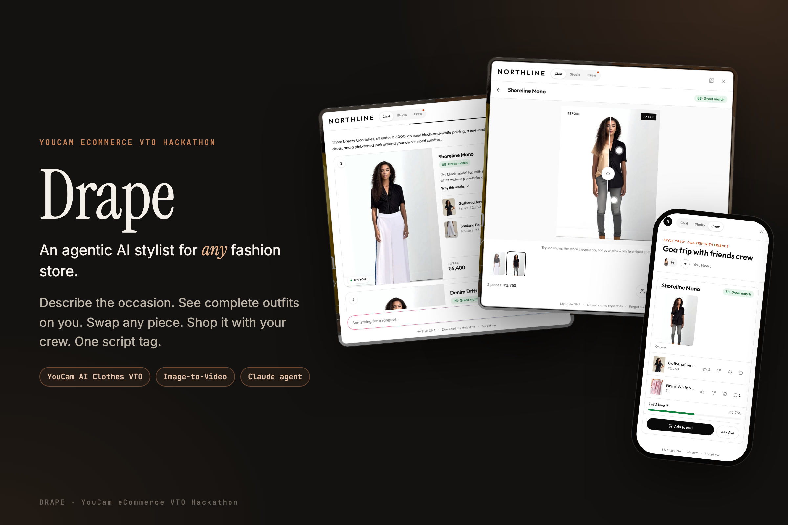
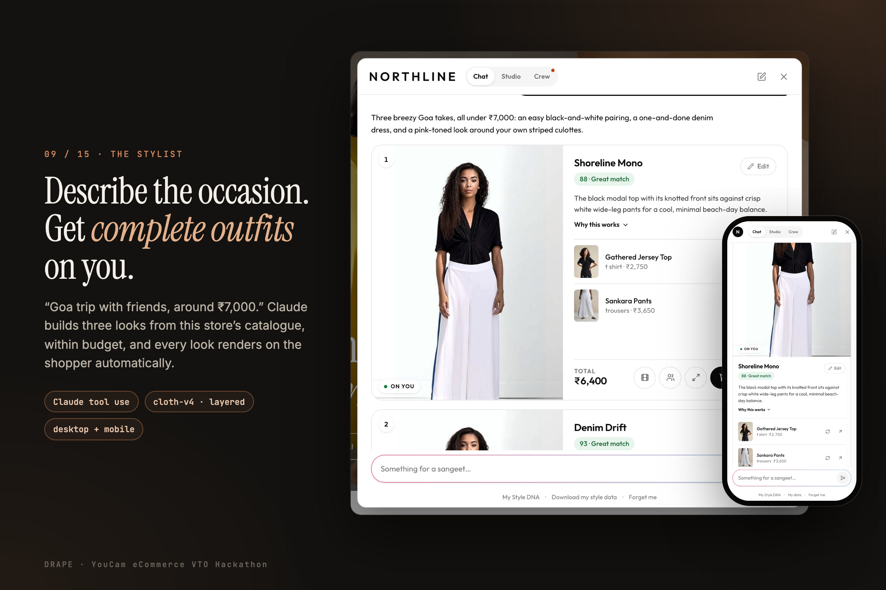
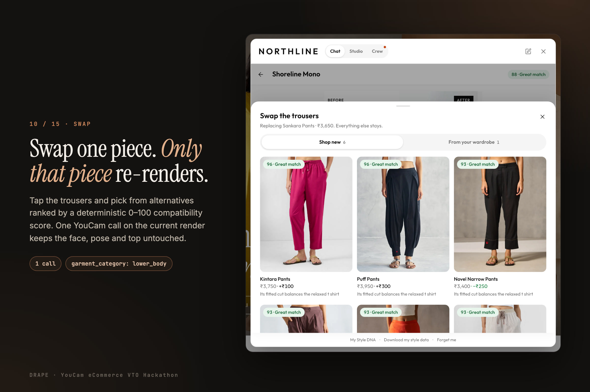
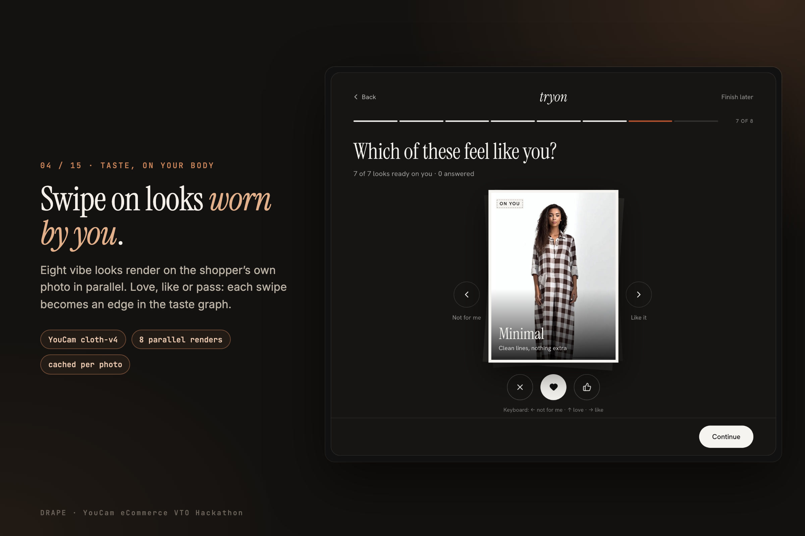
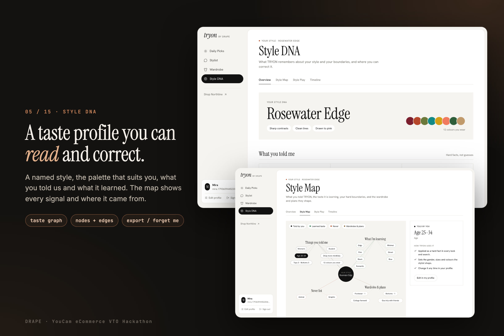
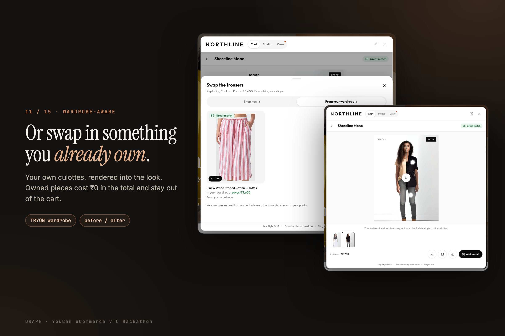
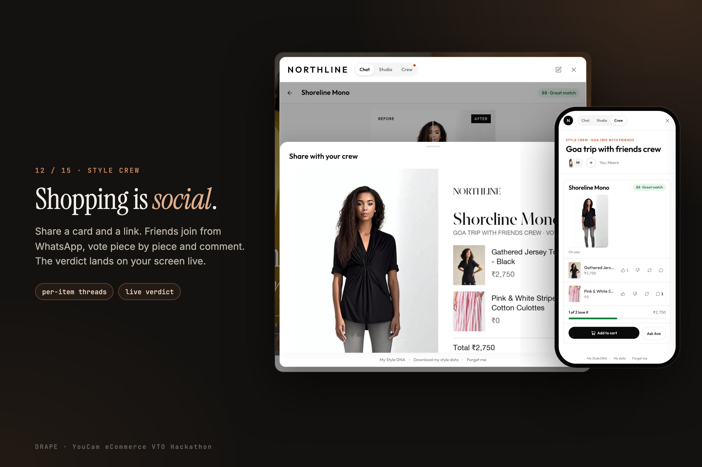
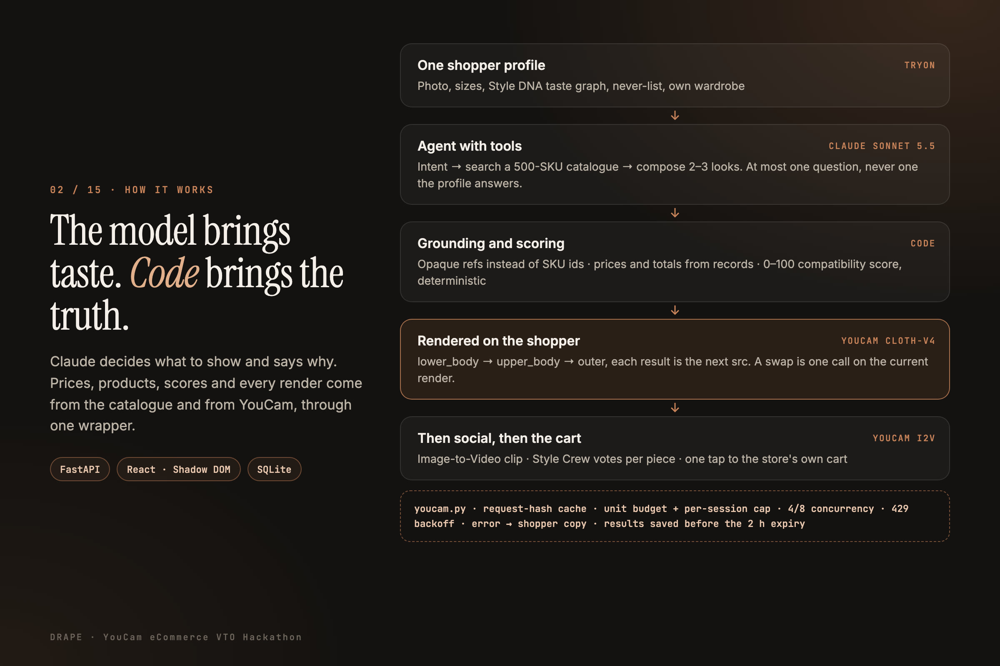
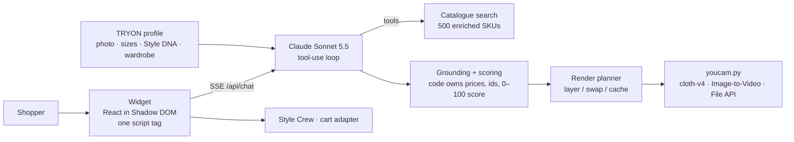

# Drape

**An agentic AI stylist for any fashion store.** A store adds one script tag. The shopper describes an occasion, Claude builds complete outfits from that store's catalogue, and **YouCam AI Clothes VTO renders every look on the shopper's own photo**. The shopper can swap one piece (only that piece re-renders), swap in something they already own, get their friends' votes, watch the look move and send it to the cart in one tap.

Built for the **YouCam API Skin AI & eCommerce VTO Hackathon**, eCommerce VTO track.



**[Watch the 2:43 demo video](media/drape-demo.mp4)**. It was recorded in one take against the live stack: real Claude, real YouCam renders, nothing mocked.

---

## The problem

Online fashion still asks shoppers to do the stylist's job alone. They have to:
- find each piece themselves;
- imagine it on their own body;
- guess what goes with it;
- ask friends in a WhatsApp group the store never sees.

Every one of those gaps costs a sale or causes a return. Try-on today is usually a button on one product page. It only helps after the shopper already knows what to try.

## What Drape does

| | |
|---|---|
| **One profile, everywhere** | **TRYON by Drape** builds a style profile once: goal, sizes, a selfie (Claude reads the palette that suits you) and a full-body photo. You swipe on 8 looks **rendered on you**, and the swipes become a Style DNA taste graph you can read and correct. |
| **A stylist inside the store** | "Goa trip with friends, around ₹7,000." Claude searches the store's 500-SKU catalogue and builds 2–3 complete looks within budget. Every look starts rendering on the shopper's photo as soon as it arrives. It asks at most one question, and never one the profile already answers. |
| **Swap one piece** | Tap the trousers and pick from alternatives ranked by a deterministic 0–100 compatibility score. **One YouCam call on the current render**: the face, pose and top stay exactly as they were. |
| **Wardrobe-aware** | Upload a photo of your own clothes and every piece is recognised and tagged. Swap in your own culottes: owned pieces cost ₹0 in the total and stay out of the cart. |
| **Style Crew** | Share a card and a link. Friends join from WhatsApp, vote piece by piece and comment. The verdict lands on the owner's screen live. |
| **Gifting** | "College farewell outfit for my brother, he's 20." The agent works out who it is for, skips the gender question and renders on a matching model. A look is never rendered on a photo of the other gender. |
| **See it move** | YouCam Image-to-Video turns a finished look into a 5-second clip. |
| **One-tap cart** | The whole look goes into the store's own cart, with sizes taken from the profile. |

<table>
<tr><td></td><td></td></tr>
<tr><td></td><td></td></tr>
<tr><td></td><td></td></tr>
</table>

All 15 gallery images are in [`media/gallery/`](media/gallery).

## How we use the YouCam API

Every call goes through one module, [`backend/app/youcam.py`](backend/app/youcam.py). Nothing else in the repo talks to YouCam.

| Mode | API | Calls | Where |
|---|---|---|---|
| Single piece on you | AI Clothes VTO `cloth-v4` | 1 | Product cards, "try this piece" |
| Full outfit, layered | `cloth-v4`: `lower_body` → `upper_body` → `outer`, **each result is the next `src`** | 2–3 sequential | Every look the agent shows |
| One-piece look | `cloth-v4` `full_body` | 1 | Dresses, sets |
| Swap one piece | `cloth-v4` on the **current render**, the slot's category only | 1 | Viewer → hotspot → swap drawer |
| Taste on your body | `cloth-v4` × 8 in parallel | 8 | Onboarding vibe swipe |
| See it move | AI Image-to-Video (480p, 5 s) | 1 | Viewer |
| Photo upload, render re-upload | File API | 0 units | Session photo; a stored render becomes the `src` for a swap |

Bottom first, then top, so the top's hem sits over the trousers.

**How the wrapper stays within the unit budget:**
- A request-hash cache keyed on the source photo, garment, category and shoe setting. Crew members viewing the same look cost 0 units.
- A unit budget, plus a cap of 20 live renders per session.
- Concurrency limits of 4 calls per session and 8 overall, and polling every 2 s, because polls count toward the rate limit.
- Backoff on 429, and a map from each error code to plain copy for the shopper.
- Results are downloaded immediately, before the signed URLs expire after 2 h.
- `YOUCAM_DEMO_MODE=1` serves only real cached renders.

Every call is logged, with cache hits, units and latency, at **`/admin/renders`**. During the build that came to 129 live calls and 91 cache hits.

Full notes, including the walls we hit and the workarounds: [docs/youcam-usage.md](docs/youcam-usage.md).

## Architecture





**The model brings taste; code brings the truth.**
- Claude sees opaque refs (`c_12`), never SKU ids. Code maps them back.
- Prices, totals, images, scores and renders come only from catalogue records, code and YouCam.
- An invalid look gets one repair attempt, then is dropped. Nothing is invented to fill a slot.
- If Claude fails, a deterministic composer answers, so a turn never ends empty.

| Layer | Stack |
|---|---|
| Backend | Python 3.12, FastAPI, SQLite, `uv` |
| Agent | Claude Sonnet 5.5 (tool use, strict tools), Claude vision for selfie colours and wardrobe tagging |
| Widget + store + TRYON | Vite, React, TypeScript, Tailwind; widget mounted in a Shadow DOM |
| Tests | pytest, Playwright (desktop + mobile), agent evals |

## Try it in 60 seconds (judges)

With the app running locally (next section):

1. **<http://localhost:5173/tryon/login>**: click **Try the demo profile** to open Priya, who has a finished Style DNA and an 8-piece wardrobe. Or sign up to go through onboarding yourself.
2. **<http://localhost:5173>**: open the stylist and pick an opener, or type *"Goa trip next week with friends, budget around ₹7,000"*.
3. On a look, click **⤢**, then tap the trousers to swap them. Switch to **From your wardrobe**.
4. Click **Share with Crew**, open the link in a private window and vote as a friend.
5. **<http://localhost:5173/judge>** has the scripted prompts, and **<http://localhost:5173/admin/renders>** shows every YouCam call.

## Run it locally

Prerequisites: Python ≥ 3.12 with [uv](https://docs.astral.sh/uv/), Node ≥ 20 with pnpm.

1. Clone the repo and copy the env file:
   ```bash
   git clone https://github.com/jainrishi601/VTRYON.git && cd VTRYON
   cp .env.example .env
   ```
2. Put your YouCam key in `.env` as `YOUCAM_API_KEY` ([YouCam API console](https://yce.makeupar.com/api-console)).
3. Add `ANTHROPIC_API_KEY` too. Without it, a deterministic composer answers instead of Claude.
4. Install the backend and seed the demo data (the store shopper, the Goa trip crew and Priya's TRYON profile):
   ```bash
   cd backend && uv sync && cd ..
   uv run --project backend python scripts/seed_demo.py
   uv run --project backend python scripts/seed_tryon_demo.py
   ```
5. Start the API:
   ```bash
   cd backend && uv run uvicorn app.main:app --port 8000
   ```
6. In a second terminal, start the web app:
   ```bash
   cd web && pnpm i && pnpm dev
   ```
7. Open <http://localhost:5173>.

**To spend zero YouCam units,** set `YOUCAM_DEMO_MODE=1`. Only renders that are already cached are served.

**To pre-render the demo content,** run `uv run --project backend python scripts/prerender.py`. It prints the plan and the unit cost; add `--yes` to spend.

## Embed on any store

```html
<script src="https://<host>/widget.js"
        data-store-id="your-store"
        data-api="https://<host>"
        data-position="bottom-center"
        data-cart-adapter="shopify"></script>
```

**Cart adapters:**
- `shopify` posts to `/cart/add.js`.
- `custom` calls `window.drapeAddToCart(items)`.

**Hooks:**
- Any element with `data-drape-tryon="<productId>"` becomes a try-on button.
- `window.Drape.open({ tab, productId, message })` opens the stylist from your own UI.

**Product feed:** one JSON row per product, as in [`data/products.json`](data/products.json). The required fields are `id, title, price, currency, image_url, gender, category`. Everything else is enriched once, at ingestion. Bottoms need an on-model image, because YouCam's lower-body references must be worn photos.

## Tests

```bash
cd backend && uv run pytest -q                          # 112 unit tests, no network
uv run --project backend python scripts/run_evals.py    # agent evals, live Claude, renders stubbed
pnpm --dir e2e test                                     # Playwright, desktop + mobile, zero units
```

## Recreate the demo video and gallery

The demo video and the gallery images are generated from the app itself. With the app running, these spend about 20 YouCam units:

```bash
cd e2e
DEMO_BASE=http://localhost:5173 node demo/record.mjs && python3 demo/cut.py   # → var/demo/demo.mp4
node demo/shots.mjs && node demo/gallery.mjs                                   # → ../media/gallery/*.jpg
```

## Repo map

```
backend/   FastAPI: agent (Claude), YouCam wrapper, render planner, scoring, taste graph, crew, TRYON, SQLite
web/       Vite + React + Tailwind: Northline store, the embeddable widget (Shadow DOM), TRYON app
data/      products.json (enriched catalogue), demo_looks.json, sample models
scripts/   build_catalog.py, prerender.py, seed_demo.py, seed_tryon_demo.py, run_evals.py
e2e/       Playwright tests; demo/ records the video and builds the gallery
media/     demo video and Devpost gallery
docs/      architecture, agent spec, YouCam usage, design, test plan, tracker, decisions
```

| Doc | What it covers |
|---|---|
| [docs/ARCHITECTURE.md](docs/ARCHITECTURE.md) | System design and the API contract |
| [docs/AGENT_SPEC.md](docs/AGENT_SPEC.md) | Agent behaviour, tools, scoring, taste graph, evals |
| [docs/youcam-usage.md](docs/youcam-usage.md) | Every YouCam endpoint, its cost, and what we learned |
| [docs/DECISIONS.md](docs/DECISIONS.md) | Scope and design decisions |
| [docs/TRACKER.md](docs/TRACKER.md) | Feature status and acceptance checks |

## Privacy and safety

- Photos are used only for try-on. **Forget me** deletes the profile, the taste graph, the photos and the renders. **Download my style data** exports them.
- A look is never rendered on a photo of the other gender. Minors are never rendered.
- API keys stay on the server; the widget never sees them.

## Licence

MIT. The demo catalogue images belong to their original owner. They are used for a non-commercial hackathon demo, with brand names removed. Sample model photos: a YouCam demo asset and Unsplash Licence images (see `data/models/models.json`).
